

<picture>
  <source media="(prefers-color-scheme: dark)" srcset="./assets/banner-dark.svg">
  
</picture>

 
 

### Breaking down the barriers that keep people from the support they need.

 

<picture>
  <source media="(prefers-color-scheme: dark)" srcset="./assets/badges-dark.svg">
  
</picture>

 

[**Who we are**](#who-we-are) &nbsp;·&nbsp; [**Our story**](#our-story) &nbsp;·&nbsp; [**Our vision**](#our-vision) &nbsp;·&nbsp; [**The team**](#the-team)

 

<picture>
  <source media="(prefers-color-scheme: dark)" srcset="./assets/title-who-we-are-dark.svg">
  
</picture>

**Relay Collective** is a technology-driven social impact initiative focused on breaking down the barriers that prevent vulnerable individuals from accessing essential services.

We believe that when community organizations, volunteers, and the people they serve are connected, communities become stronger, more resilient, and more caring. Technology is how we build those connections.

<table>
  <tr>
    <td width="33%" valign="top" align="center">
       
      <h3>🤝</h3>
      <b>Connect</b>
        
      Bringing community organizations, volunteers, and the people they serve into one network.
        
    </td>
    <td width="33%" valign="top" align="center">
       
      <h3>🧱</h3>
      <b>Remove barriers</b>
        
      Finding the gaps that keep people from essential services, and building what's needed to close them.
        
    </td>
    <td width="33%" valign="top" align="center">
       
      <h3>🌱</h3>
      <b>Strengthen communities</b>
        
      Giving the organizations that do the work on the ground better tools to work together.
        
    </td>
  </tr>
</table>

<picture>
  <source media="(prefers-color-scheme: dark)" srcset="./assets/title-our-story-dark.svg">
  
</picture>

Relay Collective started as Hackathon Project at **FaithTech's HACKVAN 2026**, developed in collaboration with **The Salvation Army – Belkin Communities of Hope**.

Working alongside people on the front lines showed us where the barriers really are. Our first focus became clear: making **transportation** more **accessible**, **reliable**, and **inclusive**, because getting there is so often the first barrier between a person and the help that already exists.

That project has since grown into a long-term initiative. We're continuing to develop technology that connects community organizations, volunteers, and the people who need them most.

<picture>
  <source media="(prefers-color-scheme: dark)" srcset="./assets/title-our-vision-dark.svg">
  
</picture>

Transportation is where we started, but it isn't where we stop.

<picture>
  <source media="(prefers-color-scheme: dark)" srcset="./assets/vision-dark.svg">
  
</picture>

Relay Collective aims to grow **beyond transportation into a broader collaboration platform for nonprofits**: one place where organizations can share resources, coordinate volunteers, and work together to serve their communities.

Nonprofits do extraordinary work, but too often they do it alone, with limited tools and little connection to each other. We want to change that by building the shared infrastructure that lets the whole sector **work as a collective**.

<picture>
  <source media="(prefers-color-scheme: dark)" srcset="./assets/title-the-team-dark.svg">
  
</picture>

Relay Collective is designed and built by three developers who believe technology should serve the people who need it most.

 

<a href="https://github.com/maxiomattic" title="Noah Hamm on GitHub"><picture>
  <source media="(prefers-color-scheme: dark)" srcset="./assets/team-maxiomattic-dark.svg">
  
</picture></a>
<a href="https://github.com/adi-padmarajan" title="Aditya Padmarajan on GitHub"><picture>
  <source media="(prefers-color-scheme: dark)" srcset="./assets/team-adi-padmarajan-dark.svg">
  
</picture></a>
<a href="https://github.com/gilbertfung" title="Gilbert Fung on GitHub"><picture>
  <source media="(prefers-color-scheme: dark)" srcset="./assets/team-gilbertfung-dark.svg">
  
</picture></a>

 

 

<picture>
  <source media="(prefers-color-scheme: dark)" srcset="./assets/footer-dark.svg">
  
</picture>
