<a href="https://relay-collective.relay-collective.workers.dev/"></a>

  
  


 
 



 
 

 
 


Nonprofits do extraordinary work, but too often they do it alone, each with its own tools, its own volunteer lists, and its own resources. **Relay Collective is the infrastructure they share:** organizations, teams, roles, and requests on one open foundation, with services on top. Every new service, from transportation to volunteering to resource sharing, starts from what the others have already proven.

  

  
  &nbsp;
  

 

Transportation is the first service built on the foundation, and it shows how the whole collective works: an organization makes a request, a verified volunteer answers it, and everyone can see it through to the end.

 
 


 
 


 
 

Relay Collective began at **FaithTech HACKVAN 2026**, built alongside **The Salvation Army – Belkin Communities of Hope** in Vancouver, BC. Front-line staff showed us how often people miss out on help that already exists, so we started with the most common barrier, **getting there**. The vision was always bigger: **one foundation where nonprofits share what they have and volunteers find where they're needed.** Within weeks, a hackathon project became that foundation.

Relay Collective is an independent platform, open to any organization. The Salvation Army is our pilot partner, not our owner.

 

  <a href="https://relay-collective.relay-collective.workers.dev/register?role=partner"></a>
  <a href="https://relay-collective.relay-collective.workers.dev/register?role=driver"></a>
  <a href="https://relay-collective.relay-collective.workers.dev/demo"></a>
  <a href="https://github.com/Relay-Collective/Relay-Collective/blob/main/docs/DEVELOPMENT.md"></a>

 

<a href="https://relay-collective.relay-collective.workers.dev/"></a>
